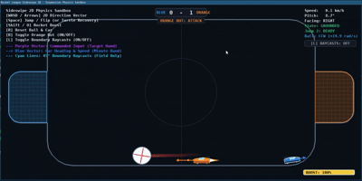

# ME5418_RocketLeague

> Team 41:
> Lu Jia Yih Jensen, Benjamin Teh Jhen Hing, Wee Fook Choon

---

A high-fidelity 2D vertical-plane robotic simulation platform and deep reinforcement learning framework modeling vehicle-ball interaction, aerial maneuvering, and **Dueling Deep Q-Network (Dueling DQN)** control inspired by **Rocket League Sideswipe**.

## 

---

## 1. Project Overview

- **Physics Engine**: Deterministic $240\text{ Hz}$ physics solver ($60\text{ Hz} \times 4\text{ sub-steps}$) powered by Pymunk (Chipmunk2D).
- **Vehicle Dynamics**: Raycast spring-damper suspension, Coulomb tire traction, 2D vector steering, two-stage jump-dodge ballistics, rocket boost aerodynamics, and turtle auto-recovery.
- **Opponent AI**: Rule-based Hierarchical Zone & Intercept State Machine (HZISM) acting as an adversarial baseline.
- **RL Interface**: Standard Gymnasium environment (`rocket-league-v1`) with continuous/box observation space (52 normalized features) and discrete/factored action spaces (`Discrete(36)` / `MultiDiscrete([9, 2, 2])`).
- **Neural Network Architecture**: PyTorch **Dueling Deep Q-Network (`DQN`)** with `LayerNorm`-stabilized shared feature extraction and decoupled State-Value $V(s)$ and Action-Advantage $A(s, a)$ streams.

## 2. Architecture & Modular Documentation

Detailed technical specifications and mathematical formulations are organized modularly within each subsystem directory:

- 🧠 **[Dueling DQN Neural Network (`src/algorithms/dqn/model.py`)](./src/neural_nets/ddqn_torch.py)**: PyTorch `nn.Module` supporting standard and Dueling DQN streams, `LayerNorm` stabilization, and standalone forward/backward pass verification.
- 📚 **[System & RL Environment (`src/README.md`)](./src/README.md)**: Gymnasium observation/action spaces, reward shaping formulation, telemetry API, and control scheme.
- ⚙️ **[Physics & Vehicle Kinematics (`src/core/README.md`)](./src/sim/core/README.md)**: Suspension equations, Coulomb traction, attitude control, jump ballistics, ball restitution/drag, and arena geometry.
- 🤖 **[Opponent AI Architecture (`src/ai/README.md`)](./src/sim/ai/README.md)**: Finite state machine structure, kickoff tactics, shadow defense, zone goalie interception, and aerial saves.
- 🎨 **[Visualization & HUD Telemetry (`src/visualization/README.md`)](./src/sim/visualization/README.md)**: Pygame rendering pipeline, procedural Octane chassis, vector debug visualizers, and HUD layout.

---

## 3. Quickstart & Usage

### Step 1: Extract the zipped folder, then open the directory

```bash
cd ./ME5418_Group41_RocketLeague
```

### Step 2: Environment Setup

Create and activate the Conda environment using the provided configuration:

```bash
conda env create -f environment.yml
conda activate me5418_projenv
```

_(Alternatively, install the core dependencies via pip: `pip install torch gymnasium pygame pymunk numpy matplotlib`)_

### Step 3: Demo

#### Play the game

```bash
# play interatively
python -m src --play

# play headlessly
python -m src --play --headless
```

#### Demo the gym

```bash
python -m src --demo --gym
```

#### Demo the neural network

Run the neural network demo to instantiate the Dueling DQN and verify a complete forward pass (input state $\to$ output $Q(s, a)$ values) and backward pass (Double-DQN TD Huber loss $\to$ `loss.backward()` layer gradients $\to$ `optimizer.step()`):

```bash
# Basic DQN
python -m src --demo --dqn

# Dueling DQN
python -m src --demo --ddqn
```

---

## AI Tool Declaration

We used Google Gemini and Claude Code to write and debug code. We are responsible for the content and quality of the submitted work.
