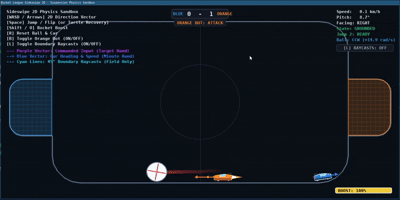

# ME5418_RocketLeague

> Team 41:
> Lu Jia Yih Jensen, Benjamin Teh Jhen Hing, Wee Fook Choon

---

A high-fidelity 2D vertical-plane robotic simulation platform and deep reinforcement learning framework modeling vehicle-ball interaction, aerial maneuvering, and autonomous control via **Dueling Double Deep Q-Network (Dueling DDQN)** and **Proximal Policy Optimization (PPO)** inspired by **Rocket League Sideswipe**.

## 

---

## 1. Project Overview

- **Physics Engine**: Deterministic $240\text{ Hz}$ physics solver ($60\text{ Hz} \times 4\text{ sub-steps}$) powered by Pymunk (Chipmunk2D).
- **Vehicle Dynamics**: Raycast spring-damper suspension, Coulomb tire traction, 2D vector steering, two-stage jump-dodge ballistics, rocket boost aerodynamics, and turtle auto-recovery.
- **Opponent AI**: Rule-based Hierarchical Zone & Intercept State Machine (HZISM) acting as an adversarial baseline.
- **RL Interface**: Standard Gymnasium environment (`rocketleague_v1`) with normalized continuous observation space and discrete/factored action spaces (`Discrete(36)` / `MultiDiscrete([9, 2, 2])`).
- **Neural Network Architectures (`src/neural_nets/`)**: Matched-capacity PyTorch architectures (`150,949` trainable parameters) with `LayerNorm`-stabilized shared feature trunks for:
  - **Dueling Double DQN (`src/neural_nets/dueling_ddqn_torch.py`)**: Decoupled State-Value $V(s)$ and Action-Advantage $A(s, a)$ streams.
  - **PPO Actor-Critic (`src/neural_nets/ppo_torch.py`)**: Decoupled categorical Policy head $\pi_\theta(a|s)$ and Critic head $V_\phi(s)$.
- **Learning Agents (`src/learning_agents/`)**: Full training and evaluation pipelines with action repeat ($4\times$), truncation-aware value bootstrapping, checkpointing, and live learning curves:
  - **Off-Policy Dueling DDQN Agent (`src/learning_agents/dueling_ddqn_agent.py`)**: Experience replay (`src/learning_agents/experience_replay.py`), Double-DQN target decoupling, Huber loss, and periodic target network synchronization.
  - **On-Policy PPO Agent (`src/learning_agents/ppo_agent.py`)**: Fixed-horizon rollout collection, Generalized Advantage Estimation ($\text{GAE}(\gamma, \lambda)$), and multi-epoch clipped surrogate minibatch updates.

## 2. Repository Structure & Main Files

```text
ME5418_Group41_RocketLeague/
├── environment.yml              # Exact Conda environment definition (me5418_projenv)
├── requirements.txt             # Same pinned versions for a plain pip / venv install
├── README.md                    # Setup, main files, verification commands, and disclosures
├── assets/                      # Architecture diagrams and demo gameplay GIF
├── trained_agent/               # Bundled pretrained checkpoints (6 Dueling DDQNs + 2 PPO v1s)
├── runs_eval/                   # Archived curriculum metrics, checkpoints, and 62,500-match tournament CSVs
└── src/
    ├── __main__.py / main.py    # Package entrypoint: `python -m src --<mode> [options]`
    ├── cli.py                   # CLI parser & mode router (--play, --eval, --train, --curriculum, --round_robin, ...)
    ├── paths.py                 # Shared ROOT_DIR, runs/, trained_agent/, and runs_eval/ paths
    ├── config/                  # Tuned simulator, reward, curriculum, NN, and agent hyperparameters
    ├── sim/                     # Custom 240 Hz Pymunk physics engine, Pygame renderer, and HZISM HeuristicBot
    ├── gym_env/                 # Gymnasium `rocketleague_v1` wrapper, reward shaping, and `Discrete(36)` action codec
    ├── neural_nets/             # PyTorch networks (`DQN`, `ActorCritic`, `SeparateActorCritic`) & checkpoint loader
    ├── learning_agents/         # Custom `DuelingDDQNAgent`, `PPOAgent`, `PPOv2Agent`, replay/rollout buffers & plotter
    ├── curriculum_learning/     # Automated multi-stage `Curriculum` manager & `CurriculumEnv`
    └── eval/                    # Side-swapped `--round_robin`, `--best_checkpoint`, `--head_to_head`, and `--eval --mix`
```

**Bundled Pretrained Models (`trained_agent/`):**
- **Default Dueling DDQN (`--eval --dueling_ddqn`):** `trained_agent/b_model_dueling_ddqn_s3_self_r1_ep021500.pt` (Rank #1, `80.48%` non-mirror win rate in the 62,500-match round robin), plus teammate `s3_self_r1` / `s3_self_r2` checkpoints (`j_model_dueling_ddqn_s3_self_r2.pt` Rank #2, `e_model_dueling_ddqn_s3_self_r1_ep006000.pt` Rank #3, etc.).
- **Default PPO v1 (`--eval --ppo`):** `trained_agent/j_model_ppo_s3_self_r2.pt` (Rank #7 overall, `#1` PPO v1 at `66.31%`), plus `j_model_ppo_s3_self_r1.pt` (Rank #9, `63.25%`).

### Modular Documentation

Detailed technical specifications and mathematical formulations are organized within each subsystem directory:

- 🤖 **[Learning Agents (`src/learning_agents/README.md`)](./src/learning_agents/README.md)**: Training (`--train`) and evaluation (`--eval`) of `DuelingDDQNAgent` (`dueling_ddqn_agent.py`) and `PPOAgent` (`ppo_agent.py`) through one shared training loop (`trainer.py`), plus policy-vs-policy matches, round-robin tournaments and best-checkpoint selection in `src/eval/`.
- 🧠 **[Neural Networks (`src/neural_nets/README.md`)](./src/neural_nets/README.md)**: PyTorch `nn.Module` definitions (`dueling_ddqn_torch.py` and `ppo_torch.py`), checkpoint loading, and standalone forward/backward pass verification (`--demo`).
- 📚 **[System & RL Environment (`src/README.md`)](./src/README.md)**: Package structure, Gymnasium observation/action spaces, reward shaping formulation, and control scheme.
- ⚙️ **[Physics & Vehicle Kinematics (`src/sim/core/README.md`)](./src/sim/core/README.md)**: Suspension equations, Coulomb traction, attitude control, jump ballistics, ball restitution/drag, and arena geometry.
- 🛡️ **[Opponent AI Architecture (`src/sim/ai/README.md`)](./src/sim/ai/README.md)**: Finite state machine structure, kickoff tactics, shadow defense, zone goalie interception, and aerial saves.
- 🎨 **[Visualization & HUD Telemetry (`src/sim/visualization/README.md`)](./src/sim/visualization/README.md)**: Pygame rendering pipeline, procedural Octane chassis, vector debug visualizers, and HUD layout.

---

## 3. Quickstart & Usage

### Step 1: Extract the zipped folder, then open the directory

```bash
cd ./ME5418_Group41_RocketLeague
```

### Step 2: Environment Setup

Create and activate the Conda environment using the provided configuration:

```bash
conda env create -f environment.yml
conda activate me5418_projenv
```

`environment.yml` pins the exact versions we tested (table below) and uses only the `conda-forge` channel, so it does not need Anaconda's `defaults` channel Terms of Service to be accepted. The first install downloads PyTorch (about 2–3 GB on Linux, where PyPI ships the CUDA build; everything runs on CPU).

_(Alternatively, in any Python 3.11 virtual environment: `pip install -r requirements.txt`, which pins the same versions.)_

#### Core Python Libraries & Simulation Engine Versions

No external simulator binaries (e.g., MuJoCo, Gazebo, Unity, or Rocket League client) are required—all rigid-body physics and rendering execute self-contained in Python via **Pymunk (Chipmunk2D)** and **Pygame**.

| Dependency / Software | Role | Pinned Version (`environment.yml` / `requirements.txt`) |
| :--- | :--- | :--- |
| **Python** | Runtime interpreter | `3.11` (tested on `3.11.18`) |
| **PyTorch (`torch`)** | Neural nets, autograd, Adam optimization | `2.15.0` |
| **Gymnasium (`gymnasium`)** | RL environment API & `TimeLimit` / `check_env` | `1.4.0` |
| **Pymunk (`pymunk`)** | External 2D physics simulation engine (Chipmunk2D) | `7.3.1` |
| **Pygame (`pygame`)** | Interactive visualization, HUD & keyboard controls | `2.6.1` |
| **NumPy (`numpy`)** | Observation arrays, statistics & rolling smoothing | `1.26.4` |
| **Matplotlib (`matplotlib`)** | Training dashboards & learning curve comparisons | `3.11.2` |
| **Pillow (`pillow`)** | Evaluation GIF export (`--gif`) | `13.0.0` |

### Step 3: Quick Marker Verification & Usage

Every command below executes from `ME5418_Group41_RocketLeague/` (`python -m src --<mode> --help` lists all options). On a clean checkout (when `runs/` has no new local runs yet), evaluation defaults automatically to the bundled **`#1` Dueling DDQN** (`trained_agent/b_model_dueling_ddqn_s3_self_r1_ep021500.pt`) and **`#7` PPO v1** (`trained_agent/j_model_ppo_s3_self_r2.pt`) playing against **`HeuristicBot`**:

```bash
# 1. Watch bundled champion Dueling DDQN / PPO v1 play against HeuristicBot (add --render for GUI window)
python -m src --eval --dueling_ddqn --episodes 5 [--render]
python -m src --eval --ppo          --episodes 5 [--render]

# 2. Mixed policy showcase: Dueling DDQN (Blue) vs PPO v1 (Orange, mirrored)
python -m src --eval --mix --dueling_ddqn --ppo --episodes 5 [--render]

# 3. Continuous head-to-head match (defaults to bundled #1 Dueling DDQN vs itself, or pass any .pt / 'none' for HeuristicBot)
python -m src --head_to_head [--headless] --max_goals 5 --max_seconds 120 --blue trained_agent/b_model_dueling_ddqn_s3_self_r1_ep021500.pt --orange trained_agent/j_model_ppo_s3_self_r2.pt

# 4. Short training smoke-test (creates a timestamped run in runs/YYYYMMDD_hhmm_<model>/)
python -m src --train --dueling_ddqn --episodes 5
python -m src --train --ppo          --episodes 5

# 5. Fast headless round-robin tournament across all 8 bundled checkpoints in trained_agent/ + HeuristicBot
python -m src --round_robin --matches 5 --max_seconds 30

# 6. Plot multi-run comparative learning curves (auto-discovers runs/ or archived runs_eval/)
python -m src --plot

# 7. Short curriculum smoke-test (3 episodes per stage, one self-play round)
python -m src --curriculum --dueling_ddqn --max_stage_episodes 3 --self_play_rounds 1
```

On a CPU, commands 1–7 each finish in about a minute or less (seconds on a desktop). Good to know before running the longer commands below:
- **Full training is long.** `--train` without `--episodes N` runs until you stop it with `Ctrl+C` (the best model so far stays saved in its run folder), and a full `--curriculum` without `--max_stage_episodes N` runs for many hours until every stage plateaus.
- **Default round robin:** `python -m src --round_robin` plays 100 matches for each of the 81 pairings (8,100 matches) and takes a few minutes on a many-core desktop and longer on a laptop (it uses all CPU cores; `--matches 5` gives a quick version).
- **Display needed:** `--render`, `--play` and `--head_to_head` without `--headless` open a Pygame window; `--play` and `--eval ... --orange` wait for keyboard input until the window is closed.
- **Where files go:** new runs, comparison plots and tournament reports are written to `runs/`; `--plot --dashboard` saves next to the CSV it plots; `--gif` saves the GIF next to the evaluated checkpoint unless `--gif_path` is given.

Each training run creates its own folder `runs/YYYYMMDD_hhmm_<model_name>/` (e.g. `runs/20261115_1038_ppo_heuristic/`) and saves its checkpoint (`model_<model_name>.pt`), training log, metrics CSV, and reward/loss plots there. The current model is also snapshotted every `checkpoint_interval` episodes (set in `src/config/nn_config.py`, default 500, `0` disables) to `checkpoints/model_<model_name>_ep<NNNNNN>.pt` inside the run folder; these can be passed to `--model_path` like any other checkpoint. Once `runs/` contains a newly trained run of that model, default evaluation uses the most recent checkpoint in `runs/` unless `--model_path trained_agent/<file>.pt` is passed explicitly.

#### Train a Learning Agent

```bash
# Train Dueling Double DQN (default DQN architecture)
python -m src --train --dueling_ddqn

# Train Proximal Policy Optimization (PPO)
python -m src --train --ppo

# Optional DQN ablation variants:
python -m src --train --double_dqn
python -m src --train --dqn

# To start from a checkpoint for training (any of --dueling_ddqn / --double_dqn / --dqn / --ppo)
python -m src --train --ppo --model_path path_to_model.pt

# Limit the number of episodes
python -m src --train --ppo --episodes 2000
```

#### Curriculum Learning

Trains one agent through three stages, each starting from the previous stage's best model: no opponent, then the heuristic bot, then self-play rounds against a frozen copy of the last best model (refreshed every round). A stage ends when the 100-episode mean reward has not improved for `--patience` episodes. Each stage / round gets its own run folder (`runs/<ts>_<name>_s1_none/`, ...), and the final model is copied to `runs/<ts>_<name>_curriculum/model_<name>.pt`.

`--ppo_v2` (a post-analysis PPO variant with separate actor and critic networks and parallel envs, not parameter-matched to Dueling DDQN) stages instead evaluate the greedy policy every 500k steps (50 fixed-seed games per opponent) against the stage's opponents (empty arena / heuristic bot / heuristic bot + league + earlier self-play models) and keep the best-scoring model. Stages 1-2 end after 4 evaluations without improvement (at least 1M steps); each self-play round runs a fixed 20M env steps (see `PPOv2Config` / `CurriculumConfig`). `--league` adds frozen checkpoints (files or folders, e.g. Dueling DDQN models) to the self-play opponents (35% of episodes) and, for PPO v2, to its evaluation opponents. With PPO v2 or `--league`, self-play episodes sample their opponent from the heuristic bot (15%), the league (35%) and the agent's own frozen self-play models; without either, D3QN / PPO self-play is unchanged.

```bash
python -m src --curriculum --ppo [--patience 3000] [--self_play_rounds 2] [--max_stage_episodes N]
python -m src --curriculum --dueling_ddqn   # also --double_dqn / --dqn
python -m src --curriculum --ppo_v2 [--league trained_agent]
```

#### Evaluate a Trained Learning Agent

Optional flags for `--eval`: `[--episodes N]`, `[--no_random_spawn]` (use fixed kickoff spawns for reproducible comparisons), `[--gif]` (record the first episode as a GIF next to the checkpoint), `[--gif_path out.gif]`.

```bash
# Default: Blue = bundled #1 Dueling DDQN, Orange = Heuristic Bot
python -m src --eval --dueling_ddqn [--render] [--model_path path_to_model.pt]
# Default: Blue = bundled #7 PPO v1, Orange = Heuristic Bot
python -m src --eval --ppo          [--render] [--model_path path_to_model.pt]

# 2. Orange = Mirrored Policy, Blue = Human User (WASD/Arrows + Space + Shift)
python -m src --eval --dueling_ddqn --orange --render [--model_path path_to_model.pt]
python -m src --eval --ppo          --orange --render [--model_path path_to_model.pt]

# 3. Same-Policy Bot-vs-Bot (both Blue and Orange controlled by the same trained policy)
python -m src --eval --dueling_ddqn --bot-vs-bot [--render] [--model_path path_to_model.pt]
python -m src --eval --ppo          --bot-vs-bot [--render] [--model_path path_to_model.pt]

# 4. Mixed-Policy Bot-vs-Bot (e.g., Blue = Dueling DDQN vs Orange = PPO, or vice versa)
python -m src --eval --mix --dueling_ddqn --ppo [--render] [--blue_model path_b.pt] [--orange_model path_o.pt]
python -m src --eval --mix --ppo --dueling_ddqn [--render] [--blue_model path_b.pt] [--orange_model path_o.pt]
```

#### Continuous Head-to-Head Match (`--head_to_head`)

Run a continuous scoreboard match (goal kickoffs reset automatically; supports PPO, Dueling DDQN/DQN checkpoints via `--blue`/`--orange`, or `none`/`bot` for `HeuristicBot`).

```bash
# Default: bundled #1 Dueling DDQN vs itself (or pass checkpoints / 'none' for HeuristicBot)
python -m src --head_to_head [--blue PATH|none] [--orange PATH|none] [--random_spawn] [--seed N]

# Headless match with score/time limits
python -m src --head_to_head --headless --max_goals 5 --max_seconds 120 --blue trained_agent/b_model_dueling_ddqn_s3_self_r1_ep021500.pt --orange none
```

#### Pick the Best Checkpoint in a Run (`--best_checkpoint`)

Find the strongest model in a training run folder. Every model (`model_*.pt` plus `checkpoints/*.pt`) first plays the heuristic bot once from each side; only models with a positive goal difference qualify. The qualifiers then play king of the hill: each challenger plays the current champion once from each side, and takes over if its goal difference exceeds `--threshold`.

```bash
# Default: 300 s games, fixed kickoffs, challenger must win by more than 3 goals
python -m src --best_checkpoint runs_eval/20261116_0727_ppo_s3_self_r2

# Shorter games with repeatable random kickoffs and a lower threshold
python -m src --best_checkpoint runs_eval/20261116_0727_ppo_s3_self_r2 --max_seconds 120 --random_spawn --seed 0 --threshold 1
```

| Flag | Default | Description |
| :--- | :--- | :--- |
| `RUN_DIR` | _(required)_ | Training run folder containing `model_*.pt` and/or `checkpoints/*.pt`. |
| `--threshold N` | `3` | Goal difference (over both sides) a challenger must **exceed** to replace the champion. |
| `--max_seconds S` | `300.0` | Simulation time per game in seconds. |
| `--max_goals N` | _none_ | End a game early after this many total goals. |
| `--random_spawn` | `False` | Randomise every kickoff. |
| `--seed N` | _none_ | Seed for repeatable random spawns. |

The best model's path is printed at the end, along with a summary of every challenge. If no model beats the heuristic bot, the command stops with an error naming the closest model.

#### Plot Learning Curves & Dashboards

```bash
# Auto-discover metrics in runs/ (or fall back to archived runs_eval/) and generate multi-algorithm curves
python -m src --plot

# Generate a 4-panel dashboard for a specific agent run
python -m src --plot --dashboard runs_eval/20261115_1038_ppo_heuristic/metrics_ppo.csv
```

### Step 4: Interactive Play & Component Demos

#### Play the game interactively

```bash
# Play interactively as Blue car vs Orange Heuristic Bot (default)
python -m src --play
python -m src --play --blue

# Play interactively as Orange car vs Blue Heuristic Bot
python -m src --play --orange

# Watch bot-vs-bot match (Blue Heuristic Bot vs Orange Heuristic Bot)
python -m src --play --bot-vs-bot

# Run headless simulation benchmark
python -m src --play --headless
```

#### Demo the Gymnasium environment

```bash
python -m src --demo --gym
```

#### Demo the neural network forward & backward passes

Run the neural network demo to instantiate the network and verify a complete forward pass and backward pass (`loss.backward()` layer gradients $\to$ `optimizer.step()`):

```bash
# Dueling Double DQN (Default DQN architecture)
python -m src --demo --dueling_ddqn

# Double DQN (Single-stream head with Double-DQN target)
python -m src --demo --double_dqn

# Vanilla DQN (Single-stream head with standard max target)
python -m src --demo --dqn

# PPO Actor-Critic (Policy + Value heads with clipped surrogate + GAE update)
python -m src --demo --ppo
```

## 4. Evaluate across models

Run a headless side-swapped round-robin tournament across all `.pt` checkpoints placed in a folder (default: `trained_agent/`) together with `HeuristicBot`, using the continuous simulation engine (`Simulation` + `PolicyController` / `HeuristicController`):

```bash
# Default: single-round evaluation of all checkpoints in trained_agent/ + HeuristicBot
# (100 matches per directed Blue-vs-Orange pairing, 1-goal / 60s cap, seed 50, random spawns)
python -m src --round_robin

# Continuous mode: run unlimited rounds with advancing non-overlapping seeds until Ctrl+C
# (Round 1 uses seeds 50..149, Round 2 uses 150..249, etc.; updates standings & 95% CIs live)
python -m src --round_robin --continuous

# Custom finite multi-round run (or pass --rounds 0 for continuous)
python -m src --round_robin \
  --rounds 5 \
  --models_dir trained_agent \
  --out_dir runs/round_robin_report \
  --matches 100 \
  --max_goals 1 \
  --max_seconds 60 \
  --seed 50 \
  --workers 11
```

### Options (`python -m src --round_robin --help`)

| Flag | Default | Description |
| :--- | :--- | :--- |
| `--models_dir DIR` | `trained_agent` | Folder containing curated `.pt` checkpoints (architecture auto-inferred). |
| `--out_dir DIR` | `runs/round_robin_report` | Output folder for CSVs, raw logs, and Markdown summary report. |
| `--matches N` | `100` | Matches played per directed `(Blue, Orange)` pairing per round. |
| `--rounds N` | `1` | Number of round-robin passes (`0` runs continuously until stopped). |
| `--continuous` | `False` | Run unlimited rounds with advancing seeds until `Ctrl+C` (same as `--rounds 0`). |
| `--max_goals N` | `1` | Goals required to end a match (`0` disables goal cap). |
| `--max_seconds S` | `60.0` | Simulation time limit per match in seconds (`0-0` timeout = Draw). |
| `--seed N` | `50` | Base seed (`round r` uses `[seed + (r-1)*matches, ..., seed + r*matches - 1]`). |
| `--no_random_spawn` | `False` | Use fixed kickoff spawns instead of random spawns. |
| `--no_heuristic` | `False` | Exclude `HeuristicBot` from the tournament. |
| `--no_mirrors` | `False` | Skip `Bot vs Bot` mirror pairings. |
| `--workers N` | `cpu_count - 1` | Number of parallel CPU worker processes (`1` runs sequentially). |

### Generated Artifacts (`--out_dir`)

- `overall_standings.csv`: Ranked standings with `rank`, `best_rank`, `best_rank_seed` (first round starting seed reaching `best_rank`), `raw_win_rate_pct`, cross-round `mean_win_rate_pct`, `std_error_pct`, `95% CI` (Student-$t$ across `>= 2` rounds, Wilson score on Round 1), goal differential, and Blue/Orange splits.
- `round_samples.csv`: Per-round bot win-rate samples and seed blocks appended after each completed round.
- `pairings_summary.csv`: Cumulative per-pairing statistics for all directed `(Blue, Orange)` matchups.
- `matrix_score_b_o_d.csv`: $N \times N$ directed matrix (`BlueWins-OrangeWins-Draws`).
- `matrix_combined_matches.csv`: $N \times N$ side-swapped combined matrix (`RowWins-ColWins-Draws`).
- `matrix_blue_win_rate_pct.csv` & `matrix_blue_goal_diff.csv`: Blue win-rate and goal-differential matrices.
- `raw_matches.csv` & `raw_matches.log`: Per-match logs across rounds (`round`, `pairing_id`, `seed`, `winner`, goals, `sim_seconds`, `steps`, `last_touch`).
- `eval_report.md`: Live-updated Markdown summary containing Mean ± SE, 95% CIs, statistical leader note, round progression, and head-to-head matrices.

---

## Existing Code Disclosure & AI Tool Declaration

Over **50% of this codebase was implemented from scratch** by Team 41 (custom 240 Hz Pymunk vehicle/arena physics, HZISM `HeuristicBot`, observation reflection, `RocketLeagueEnv`, reward shaping, 4-stage `CurriculumEnv`, `--best_checkpoint`, `--round_robin`, `--head_to_head`, and training dashboards). Core RL starter patterns were adapted from:
- **`johnnycode8/dqn_pytorch`**: Base replay/training structure extended with Dueling Double DQN, Huber `SmoothL1Loss`, gradient clipping, truncation-aware bootstrapping, and curriculum checkpoint resumption (`src/learning_agents/dueling_ddqn_agent.py`).
- **`CleanRL` (`vwxyzjn/cleanrl`, `ppo.py`)**: Core GAE and clipped surrogate structure adapted for our matched-capacity and decoupled PyTorch actor-critic models, internal reward scaling (`0.05`), KL early stopping, parallel rollouts, and league evaluation (`src/learning_agents/ppo_agent.py`, `ppo_v2_agent.py`).

We used Google Gemini, Anthropic Claude to assist with physics debugging, code refactoring, and diagnostics. We are responsible for the content and quality of the submitted work.
