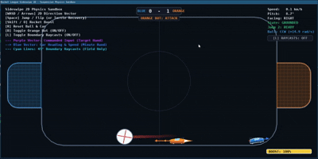

# ME5418_RocketLeague

> Team 41:
> Lu Jia Yih Jensen, Benjamin Teh Jhen Hing, Wee Fook Choon

---

A high-fidelity 2D vertical-plane robotic simulation platform and deep reinforcement learning framework modeling vehicle-ball interaction, aerial maneuvering, and autonomous control via **Dueling Double Deep Q-Network (Dueling DDQN)** and **Proximal Policy Optimization (PPO)** inspired by **Rocket League Sideswipe**.

## 

---

## 1. Project Overview

- **Physics Engine**: Deterministic $240\text{ Hz}$ physics solver ($60\text{ Hz} \times 4\text{ sub-steps}$) powered by Pymunk (Chipmunk2D).
- **Vehicle Dynamics**: Raycast spring-damper suspension, Coulomb tire traction, 2D vector steering, two-stage jump-dodge ballistics, rocket boost aerodynamics, and turtle auto-recovery.
- **Opponent AI**: Rule-based Hierarchical Zone & Intercept State Machine (HZISM) acting as an adversarial baseline.
- **RL Interface**: Standard Gymnasium environment (`rocket-league-v1`) with normalized continuous observation space and discrete/factored action spaces (`Discrete(36)` / `MultiDiscrete([9, 2, 2])`).
- **Neural Network Architectures (`src/neural_nets/`)**: Matched-capacity PyTorch architectures (`150,949` trainable parameters) with `LayerNorm`-stabilized shared feature trunks for:
  - **Dueling Double DQN (`src/neural_nets/dueling_ddqn_torch.py`)**: Decoupled State-Value $V(s)$ and Action-Advantage $A(s, a)$ streams.
  - **PPO Actor-Critic (`src/neural_nets/ppo_torch.py`)**: Decoupled categorical Policy head $\pi_\theta(a|s)$ and Critic head $V_\phi(s)$.
- **Learning Agents (`src/learning_agents/`)**: Full training and evaluation pipelines with action repeat ($4\times$), truncation-aware value bootstrapping, checkpointing, and live learning curves:
  - **Off-Policy Dueling DDQN Agent (`src/learning_agents/dueling_ddqn_agent.py`)**: Experience replay (`src/learning_agents/experience_replay.py`), Double-DQN target decoupling, Huber loss, and periodic target network synchronization.
  - **On-Policy PPO Agent (`src/learning_agents/ppo_agent.py`)**: Fixed-horizon rollout collection, Generalized Advantage Estimation ($\text{GAE}(\gamma, \lambda)$), and multi-epoch clipped surrogate minibatch updates.

## 2. Architecture & Modular Documentation

Detailed technical specifications and mathematical formulations are organized modularly within each subsystem directory:

- 🤖 **[Learning Agents (`src/learning_agents/`)](./src/learning_agents/)**: End-to-end training (`--train`) and evaluation (`--eval`) loops for `DuelingDDQNAgent` (`dueling_ddqn_agent.py`), `PPOAgent` (`ppo_agent.py`), and `ReplayMemory` (`experience_replay.py`).
- 🧠 **[Neural Networks (`src/neural_nets/`)](./src/neural_nets/)**: PyTorch `nn.Module` definitions (`dueling_ddqn_torch.py` and `ppo_torch.py`) and standalone forward/backward pass verification (`--demo`).
- 📚 **[System & RL Environment (`src/README.md`)](./src/README.md)**: Package structure, Gymnasium observation/action spaces, reward shaping formulation, and control scheme.
- ⚙️ **[Physics & Vehicle Kinematics (`src/sim/core/README.md`)](./src/sim/core/README.md)**: Suspension equations, Coulomb traction, attitude control, jump ballistics, ball restitution/drag, and arena geometry.
- 🛡️ **[Opponent AI Architecture (`src/sim/ai/README.md`)](./src/sim/ai/README.md)**: Finite state machine structure, kickoff tactics, shadow defense, zone goalie interception, and aerial saves.
- 🎨 **[Visualization & HUD Telemetry (`src/sim/visualization/README.md`)](./src/sim/visualization/README.md)**: Pygame rendering pipeline, procedural Octane chassis, vector debug visualizers, and HUD layout.

---

## 3. Quickstart & Usage

### Step 1: Extract the zipped folder, then open the directory

```bash
cd ./ME5418_Group41_RocketLeague
```

### Step 2: Environment Setup

Create and activate the Conda environment using the provided configuration:

```bash
conda env create -f environment.yml
conda activate me5418_projenv
```

_(Alternatively, install the core dependencies via pip: `pip install torch gymnasium pygame pymunk numpy matplotlib`)_

### Step 3: Train & Evaluate Learning Agents

All learning agent training and evaluation commands are executed from the project root (`ME5418_Group41_RocketLeague/`). Checkpoints, training logs, and reward/loss plots are automatically saved to `runs/`.

#### Train a Learning Agent

```bash
# Train Dueling Double DQN (default DQN architecture)
python -m src --train --dueling_ddqn

# Train Proximal Policy Optimization (PPO)
python -m src --train --ppo

# Optional DQN ablation variants:
python -m src --train --double_dqn
python -m src --train --dqn
```

#### Evaluate a Trained Learning Agent

```bash
# Evaluate Dueling Double DQN (headless or with live Pygame rendering)
python -m src --eval --dueling_ddqn
python -m src --eval --dueling_ddqn --render

# Evaluate PPO (headless or with live Pygame rendering)
python -m src --eval --ppo
python -m src --eval --ppo --render
```

#### Plot Learning Curves & Dashboards

```bash
# Auto-discover runs/ metrics and generate multi-algorithm comparative curves
python -m src --plot

# Generate a 4-panel dashboard for a specific agent run
python -m src --plot --dashboard runs/metrics_ppo.csv
```

### Step 4: Interactive Play & Component Demos

#### Play the game interactively

```bash
# Play interactively as Blue car vs Orange Heuristic Bot (default)
python -m src --play
python -m src --play --blue

# Play interactively as Orange car vs Blue Heuristic Bot
python -m src --play --orange

# Watch bot-vs-bot match (Blue Heuristic Bot vs Orange Heuristic Bot)
python -m src --play --bot-vs-bot

# Run headless simulation benchmark
python -m src --play --headless
```

#### Demo the Gymnasium environment

```bash
python -m src --demo --gym
```

#### Demo the neural network forward & backward passes

Run the neural network demo to instantiate the network and verify a complete forward pass and backward pass (`loss.backward()` layer gradients $\to$ `optimizer.step()`):

```bash
# Dueling Double DQN (Default DQN architecture)
python -m src --demo --dueling_ddqn

# Double DQN (Single-stream head with Double-DQN target)
python -m src --demo --double_dqn

# Vanilla DQN (Single-stream head with standard max target)
python -m src --demo --dqn

# PPO Actor-Critic (Policy + Value heads with clipped surrogate + GAE update)
python -m src --demo --ppo
```

---

## AI Tool Declaration

We used Google Gemini and Claude Code to write and debug code. We are responsible for the content and quality of the submitted work.
